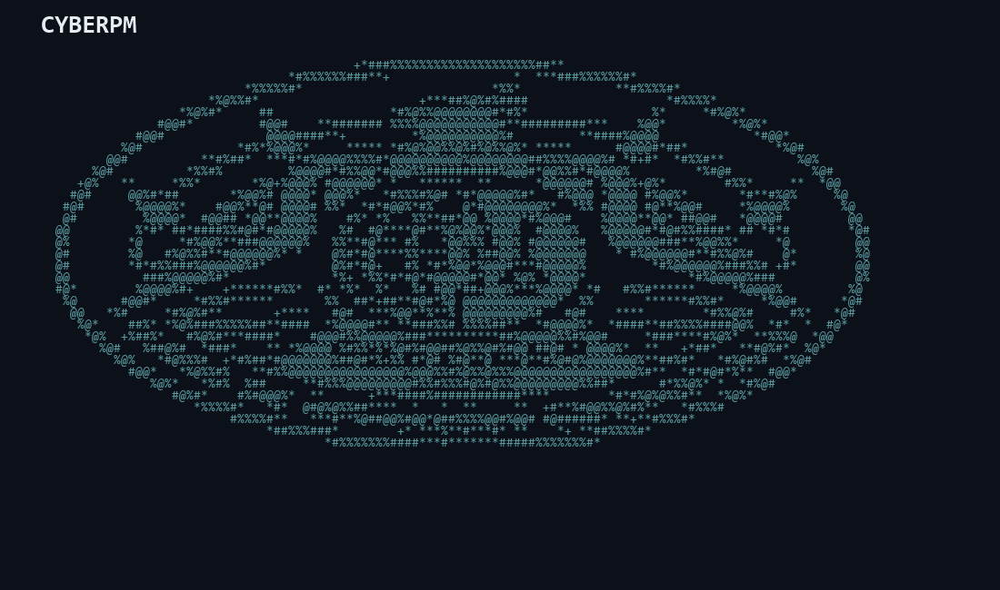
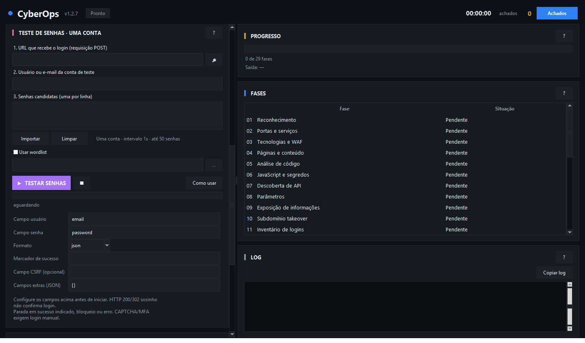

<p align="center">
  
</p>

# Cyberpm — 1.4

**Ferramenta de apoio à auditoria de segurança de aplicações web para Kali Linux**, com interface gráfica, execução pelo terminal, reconhecimento de domínios, inventário técnico, acompanhamento das fases, relatórios HTML e integração opcional com Telegram.

**Repositório oficial:** https://github.com/Luistn/Cyberpm
**Versão do programa:** 1.4 · **Release técnica:** v1.7.2

> **Uso autorizado:** execute verificações ativas somente em sistemas próprios ou com autorização expressa. URLs de terceiros identificadas durante a coleta, como CDNs e redes sociais, não passam automaticamente a integrar o escopo autorizado. Um alerta automatizado não comprova, por si só, uma vulnerabilidade.

## Interface do sistema



*Prévia da arte ASCII usada na abertura. O tamanho se adapta à janela; a aparência das fontes pode variar conforme o ambiente.*

## Para que serve?

O **Cyberpm** reúne em uma interface única recursos de apoio à análise de aplicações web:

- **Reconhecimento de domínio:** consultas públicas WHOIS, RDAP e DNS, incluindo registros e informações cadastrais divulgadas pelos serviços de registro.
- **Inventário técnico:** identificação de serviços, tecnologias, páginas, arquivos JavaScript, endpoints e APIs.
- **Verificações de segurança:** organização de até 29 fases, de acordo com as ferramentas instaladas e a aplicabilidade ao alvo.
- **Acompanhamento:** visualização de progresso, logs e achados durante a execução.
- **Relatórios:** geração de HTML ao concluir ou interromper uma análise, com os resultados disponíveis até aquele momento.
- **Telegram:** notificações e tentativa de envio do relatório para um chat configurado.
- **Terminal ou Cyberpm:** execução por comandos `cyberpm` ou pela interface gráfica.

**Novidades da versão 1.4:** atalhos para Scan PHP e John the Ripper na fileira principal, busca de perfis públicos com Sherlock e botões de ajuda compactos. O John trabalha com hashes locais; o Sherlock pesquisa nomes de usuário em serviços públicos.

**Limitações:** nem todas as fases se aplicam a todos os sites. Algumas dependem de ferramentas externas não instaladas pelos requisitos básicos. Informações de titulares e contatos podem estar ocultas por privacidade. Resultados precisam ser revisados manualmente.

## Instalação no Kali Linux — passo a passo

### 1. Instale os requisitos básicos

Abra o terminal do Kali e execute os comandos **separadamente**:

```bash
sudo apt update
sudo apt install -y git python3 python3-tk bash curl whois dnsutils
```

### 2. Baixe o projeto oficial

```bash
git clone https://github.com/Luistn/Cyberpm.git
```

### 3. Entre na pasta criada

```bash
cd Cyberpm
```

### 4. Instale o comando `cyberpm`

```bash
bash instalar.sh
```

O instalador cria um atalho para o executável em `~/.local/bin/cyberpm`. **Mantenha a pasta clonada**, pois o atalho aponta para os arquivos nela.

### 5. Abra um novo terminal e teste

```bash
cyberpm --h
cyberpm --versao
cyberpm open
```

Se aparecer `cyberpm: command not found`, adicione `~/.local/bin` ao `PATH`. No Kali, que geralmente usa Zsh:

```bash
export PATH="$HOME/.local/bin:$PATH"
echo 'export PATH="$HOME/.local/bin:$PATH"' >> ~/.zshrc
source ~/.zshrc
```

Se estiver usando Bash, substitua `~/.zshrc` por `~/.bashrc`.

### 6. Faça a primeira utilização

Na interface, informe **um alvo autorizado**, escolha o modo e as fases desejadas e inicie a análise. Acompanhe as áreas de **Log**, **Fases**, **Achados** e **Relatório**. Consulte o log se alguma ferramenta externa estiver ausente.

**Alternativa sem Git:** na [página do projeto](https://github.com/Luistn/Cyberpm), clique em **Code → Download ZIP**, extraia o conteúdo, abra o terminal na pasta extraída e execute `bash instalar.sh`.

## Comandos disponíveis

### John the Ripper na interface

Na fileira superior, clique em **John**. Selecione o executável, um arquivo local de hashes
próprios ou autorizados e uma lista de palavras descompactada. O formato é opcional:
vazio usa a detecção do John; nomes como `bcrypt` dependem da versão instalada.
No Kali, instale a dependência com `sudo apt install john`.

Use **Iniciar**, acompanhe o log e use **Parar** para interromper. **Mostrar recuperadas**
consulta os resultados da última execução nessa janela. Cada execução tem seu próprio
arquivo pot e sessão em `~/.config/cyberpm/john-results/`, separado dos relatórios web
e do pot padrão do John. Esses arquivos podem conter senhas recuperadas em texto claro.
Fechar a janela ou o aplicativo interrompe o processo. O painel não depende de alvo web
nem de proxychains. Não inicia automaticamente com as 29 fases.

### Sherlock na interface

Na fileira superior, clique em **Sherlock**, informe um nome de usuário e inicie a busca
por perfis públicos. O programa Sherlock precisa estar instalado; o projeto oficial
recomenda `pipx install sherlock-project` e também oferece outros métodos. Os resultados
ficam em `~/.config/cyberpm/sherlock-results/`. Correspondências são indícios e podem
ser falsos positivos. Use a busca apenas para fins legítimos e respeitando as regras dos
serviços consultados.

**Scan PHP** também está na fileira superior e continua usando o alvo preenchido no painel.
Os botões de ajuda `?` usam tamanho compacto; as demais ferramentas ficam organizadas na
seção **AÇÕES**.

```bash
cyberpm                                  # atualiza automaticamente e abre a interface
cyberpm open                             # abre a interface gráfica
cyberpm --h                              # exibe a ajuda
cyberpm --versao                         # exibe a versão instalada
cyberpm --alvo "https://exemplo.com" --rapido
cyberpm --alvo "https://exemplo.com" --completo
cyberpm --alvo "https://exemplo.com" --profundo
cyberpm --alvo "https://exemplo.com" --fases 1,2,3,6
cyberpm --alvo "https://exemplo.com" --completo --obs "Auditoria autorizada"
cyberpm --atualizar                      # verifica novas versões
```

Para ambientes de teste com **HTTP Basic**, há suporte a `--usuario conta_teste --pedir-senha`. A senha é solicitada sem ser mostrada no terminal. Isso **não equivale a login automático em formulários web**. Não coloque senhas em `--obs` ou em comandos compartilhados.

## Telegram — configurar notificações e relatórios

A integração é opcional. O tutorial completo está em **[docs/TELEGRAM.md](docs/TELEGRAM.md)**.

1. No Telegram, abra o bot oficial [@BotFather](https://t.me/BotFather) e envie `/newbot`.
2. Escolha o nome e o nome de usuário do bot (terminado em `bot`). Guarde o **token** fornecido; ele é secreto.
3. Abra a conversa com seu novo bot e envie `/start`.
4. Para localizar o **Chat ID**, consulte `https://api.telegram.org/botSEU_TOKEN/getUpdates` em seu navegador, substituindo `SEU_TOKEN` apenas localmente. Procure `message.chat.id`. Se `result` estiver vazio, envie uma mensagem ao bot e consulte novamente.
5. Abra `cyberpm open`. Na área **Telegram**, informe **Token** e **Chat ID**, habilite **Enviar notificações**, salve e utilize o teste de envio, se disponível.
6. Ao concluir ou interromper uma análise, o sistema tenta enviar o relatório HTML ao chat configurado. Isso depende da conexão e das permissões do bot.


> **Privacidade:** não publique token, Chat ID privado, capturas com credenciais, logs ou relatórios contendo dados sensíveis. A configuração local do Telegram não deve ser enviada ao GitHub.

## Atualizações

As versões oficiais são publicadas em: **https://github.com/Luistn/Cyberpm/releases**.

Ao abrir pelo comando `cyberpm`, o programa consulta a última release oficial. **Quando houver uma nova versão, informa, instala automaticamente e reinicia o programa. Isso requer uma instalação clonada pelo Git, na branch main, com origin oficial e sem alterações locais no código. Configurações em ~/.config/cyberpm e resultados em cyberpm-out são preservados.** Em instalações anteriores à v1.2.0, a primeira atualização ainda usa a confirmação existente: responda `s` e abra novamente.

Para que a verificação funcione, o arquivo `update_config.json` do projeto deve conter:

```json
{
  "github_repo": "Luistn/Cyberpm",
  "auto_update": true
}
```

**Verificar se existe atualização:**

```bash
cyberpm --atualizar
```

**Atualização automática para Cyberpm 1.2:** a release técnica `v1.6.6` é compatível com o atualizador antigo da `v1.6.4`. Basta executar `cyberpm`: a instalação consulta o GitHub, instala por fast-forward e reinicia. A interface mostra **1.2** e `cyberpm --versao` mostra **Cyberpm 1.2 (release 1.6.6)**. Não é necessário `git pull` manual nesta transição. A instalação deve ter sido clonada do repositório oficial, estar em `main`, sem alterações locais no código e com acesso ao GitHub. O procedimento manual abaixo permanece como alternativa para instalações sem esses requisitos.

**Atualizar uma instalação clonada com Git:**

```bash
cd ~/Cyberpm
git pull --ff-only
bash instalar.sh
```

Se você clonou o projeto em outra pasta, entre nela antes de executar `git pull`. Para quem instalou pelo ZIP, baixe a versão mais recente em [Releases](https://github.com/Luistn/Cyberpm/releases) e siga as instruções da publicação.

### Nmap, Nuclei e métodos de API

Nmap recebe o host do alvo, sem caminho de página. Nuclei recebe a raiz da mesma origem, a página selecionada e as URLs descobertas nesse host. Informar `https://app.exemplo.test/login.php` não amplia automaticamente o escopo para outros subdomínios ou para o domínio pai.

Nmap tem limite total padrão de 900 segundos (15 minutos) e Nuclei de 300 segundos (5 minutos), preservando resultados parciais para que a execução avance até CVEs e o relatório. O botão **Pular** continua disponível. Para definir limites opcionais em segundos, abra o programa com:

```bash
NMAP_TIMEOUT=900 NUCLEI_TIMEOUT=1800 cyberpm open
```

A etapa CVE examina evidências locais por até 30 segundos, com limite externo de 35 segundos, e sempre apresenta `10_cves/resumo.txt` com contagens, fontes ausentes e cobertura parcial. Não executa consulta externa a catálogo nem garante encontrar uma CVE.

O valor `0` remove o limite total de Nmap/Nuclei. Os limites das outras fases e o timeout de cada requisição do Nuclei continuam aplicáveis. Execuções interrompidas são resultados parciais; saída vazia não comprova ausência de serviços ou vulnerabilidades.

A descoberta salva endpoints e métodos de JavaScript, formulários e contratos OpenAPI em `06_api/operacoes.tsv`. Referências dinâmicas de JavaScript podem exigir análise manual. A revisão automática faz GET/OPTIONS em uma amostra de candidatos; o inventário completo não significa que todas as operações foram executadas. Atualização de recurso usa PUT ou PATCH; `UPDATE` não é método HTTP.

POST, PUT, PATCH e DELETE podem ser executados com um plano JSON explícito de rotas e dados de teste. Exemplo de `plano-api.json`, usando um registro descartável previamente criado no ambiente de teste:

```json
[
  {"method": "GET", "url": "/api/registros/registro-de-teste", "expected_status": [200]},
  {"method": "POST", "url": "/api/registros", "json": {"nome": "teste descartável"}, "expected_status": [201]},
  {"method": "PATCH", "url": "/api/registros/registro-de-teste", "json": {"nome": "teste alterado"}, "expected_status": [200, 204]},
  {"method": "DELETE", "url": "/api/registros/registro-de-teste", "expected_status": [200, 204]}
]
```

Primeiro abra com `API_REQUEST_PLAN=/caminho/plano-api.json cyberpm open`: as operações do plano serão registradas como **planejadas, não executadas**. Para executar exatamente essas requisições durante a fase de API:

```bash
API_REQUEST_PLAN=/caminho/plano-api.json API_EXECUTE_PLAN=1 cyberpm open
```

As URLs do plano devem permanecer na mesma origem do alvo, com identificadores concretos e sem placeholders. O sistema não cria IDs nem encadeia automaticamente a resposta do POST ao DELETE. Não segue redirecionamentos e não grava corpos ou cabeçalhos de autenticação no relatório. Confira o código HTTP, a sessão e o resultado esperado em `06_api/api_resultados.tsv`; um status esperado sozinho não comprova segurança ou vulnerabilidade.

## Recursos e evidências disponíveis

Selecione um candidato na tela **JS & Segredos** para ver arquivo coletado, linha, coluna e URL de origem. Auditorias antigas mostram o arquivo e a linha disponíveis; execute novamente a fase 6 para obter coluna/URL. Corrija o código-fonte ou a configuração do site e publique novamente; a cópia em cyberpm-out é apenas uma evidência local.

- **Instalação no Kali:** ao iniciar a varredura, verifica as ferramentas e tenta instalar as ausentes via apt; Retire.js usa npm com prefixo `~/.local`. O índice apt é atualizado uma vez; gau/waybackurls têm alternativa por Go quando o pacote apt não estiver disponível. Desmarque “Não instalar ferramentas” para habilitar isso. Sem privilégios, execute `sudo -v` no terminal antes de `cyberpm open`; em sessão gráfica, pkexec pode solicitar a senha do sistema. Falhas de rede, pacotes indisponíveis e falta de privilégio ficam em `00_dependencias/status.tsv` e `instalacao.log`. Docker/ZAP são integrações opcionais já instaladas e não são provisionadas automaticamente.
- **APIs:** no modo Completo/Profundo, a fase 7 executa GET e OPTIONS em até oito URLs do host, com limite de tamanho/tempo, sem seguir redirecionamentos. Prioriza rotas GET declaradas em OpenAPI que não exigem parâmetros; não inventa IDs ou corpos para POST/PUT/DELETE. Autenticação configurada é reaproveitada. Status, tempo, tipo de conteúdo, estrutura JSON e cabeçalhos CORS ficam em `06_api/api_resultados.tsv` e no relatório HTML. Respostas privadas e tokens não são copiados para esse resumo.
- **Portas:** a fase 2 salva `02_portas/portas.json`. O botão “Portas descobertas” na coluna esquerda permite escolher portas após a execução. A revisão coleta serviços, banners, cabeçalhos HTTP, certificados e chaves públicas SSH; o resultado fica em `02_portas/port_review.txt` e atualiza o relatório. Ao reabrir o programa, os resultados anteriores não são carregados automaticamente; as evidências permanecem na pasta de resultados.
- **Login:** use a URL real da requisição de autenticação, não apenas a página visual. Configure formato `json` ou `form`, nomes dos campos (ex.: `email`/`password` ou `username`/`pass`), campos extras em JSON e, se necessário, campo CSRF. Formulários reaproveitam cookies e campos ocultos. Para HTML, configure um texto exclusivo da página autenticada em “Marcador de sucesso”. HTTP 200/302 sozinho não confirma login. Há limite de 50 senhas para uma conta, intervalo de um segundo e parada em sucesso indicado, bloqueio ou erro de configuração. Wordlists são limitadas a 50 senhas, lendo no máximo 500 linhas; senhas não entram nos logs. CAPTCHA, MFA e formulários dependentes de JavaScript precisam do login manual no navegador.
- **Dados sensíveis:** `18_ident/dados_sensiveis_mascarados.tsv` reúne tipos de exposição, arquivo, linha e referência; há também uma versão JSON. Verifica CPF por checksum, e-mails, atribuições de senha/segredo, padrões de chave e JWT. Limita a leitura a 2 MB por arquivo e 2.000 candidatos; valores encontrados são exibidos completos. Isso não confirma vazamento nem coleta bancos de credenciais externos. Arquivos de evidência baixados devem permanecer privados.
- **Diagnósticos:** `fases_status.tsv` registra duração/código de cada fase; `ferramentas.tsv` registra os comandos limitados. Um timeout pode deixar resultados parciais, que precisam ser revisados. Arjun/testssl/Retire.js são omitidos no modo Rápido.
- **Limpeza local:** o botão “Limpar resultados locais” apaga, após confirmação, apenas a pasta do site selecionado dentro de `cyberpm-out` e limpa os painéis. Fica bloqueado durante testes. Não apaga configurações, logs do sistema, do servidor, arquivos enviados ao Telegram ou cópias externas.

### Verificação local

```bash
python3 -B -m unittest discover -s tests -v
bash tests/test_shell.sh
```

Os testes usam servidor HTTP local e dados fictícios; não varrem sistemas externos. As integrações apt/npm e as ferramentas reais devem ser verificadas no Kali com um alvo autorizado.

## Documentação

- [Tutorial de configuração do Telegram](docs/TELEGRAM.md)
- [Como capturar imagens reais da interface](docs/CAPTURAS.md)
- [Guia de publicação no GitHub](docs/PUBLICAR_NO_GITHUB.md)
- [Histórico de versões](CHANGELOG.md)
- [Licença MIT](LICENSE)

## Segurança e responsabilidade

Use apenas em ambientes próprios ou expressamente autorizados. Respeite o escopo e os limites de tráfego acordados. Revise manualmente os alertas antes de classificá-los como falhas confirmadas. Antes de enviar alterações ao GitHub, confira `git status` e `git diff --cached` para não publicar credenciais, tokens, cookies, relatórios ou dados privados.

A revisão de portas consulta capacidades SMTP (25/465/587), IMAP (143/993) e POP3 (110/995) quando essas portas estão no inventário e são selecionadas. Não envia mensagens nem tenta autenticação. Falhas do Nmap aparecem no log da interface e em port_review.stderr. A descoberta Nmap aceita alvos IPv6 literais.

## Diagnóstico reutilizável de bancos

O módulo `database_review.py` verifica conectividade TCP para MySQL, PostgreSQL,
SQL Server e MongoDB. O nome do banco indica o serviço esperado: conexão TCP
não confirma protocolo, versão, TLS, permissões ou vulnerabilidade.
SQLite recebe uma verificação local de integridade em modo somente leitura.
Não há tentativa de senha, exploração ou alteração de dados.

```bash
python3 database_review.py --engine mysql --host 127.0.0.1 --output mysql.json
python3 database_review.py --engine postgresql --host 127.0.0.1
python3 database_review.py --engine sqlserver --host 127.0.0.1
python3 database_review.py --engine mongodb --host 127.0.0.1
python3 database_review.py --engine sqlite --file /caminho/projeto/banco.db
```

Use `--port` para uma porta personalizada e `--timeout` entre 0 e 30 segundos
(exclusive zero). A resolução DNS depende do resolvedor do sistema e pode
ultrapassar o timeout de conexão. SQLite limita trabalho da consulta via progress
handler; esse limite não interrompe uma operação de disco bloqueada pelo sistema.
Códigos de saída: 0 para TCP acessível/integridade básica aprovada, 1 para problema
observado, 2 para configuração/arquivo inválido.

Cada resultado inclui localização, método, evidência, parâmetros de reprodução,
orientação de correção e declaração sobre exploração demonstrada. Nenhum destes
checks confirma exploração. Reexecute com os parâmetros de `reproduce` para
reproduzir a observação. Porta acessível só é problema de exposição quando o acesso
contraria a política do projeto. Erro de conexão não comprova vulnerabilidade.
No Cyberpm, a revisão de portas gera `02_portas/database_review.json` para as portas
padrão selecionadas (3306, 5432, 1433, 27017), disponível nas evidências da fase 2.
O comando separado permite diagnosticar serviços em portas personalizadas.


### Teste de senhas: como preencher



1. Preencha o Alvo e copie a URL da requisição POST de login na aba Rede/Network do navegador.
2. Informe uma conta de teste e até 50 senhas candidatas, uma por linha. Uma wordlist é um arquivo contendo essas senhas.
3. Copie os nomes dos campos enviados no POST (por exemplo, email/password) e escolha json ou form.
4. Para resposta HTML, informe um texto exclusivo da área autenticada no Marcador de sucesso. Configure CSRF/campos extras conforme o formulário real.
5. Clique em Testar senhas e consulte o log e 20_brute/login_resultados.json. HTTP 200/302 sozinho não confirma autenticação.

O teste é separado da varredura: selecionar a fase 29 não inicia tentativas automaticamente. Há intervalo de um segundo e parada em sucesso indicado, bloqueio ou erro. Pode bloquear a conta. CAPTCHA/MFA exigem login manual. A seção Acesso às páginas protegidas reaproveita uma sessão; ela tem outra finalidade.

### MAC e IP no Kali

Selecione a interface correta antes da operação. Requer iproute2, macchanger e, para DHCP, dhclient (pacote isc-dhcp-client quando disponível na distribuição), além de privilégios via pkexec/sudo. O log mostra código de saída e estados antes/depois. A troca de MAC tenta reativar uma interface originalmente ativa mesmo se houver falha. A renovação DHCP pode manter o mesmo endereço; não garante troca de IP público. As operações podem interromper a conexão e dependem de suporte do adaptador/gerenciador de rede. Foram verificadas com testes simulados; a alteração real ainda precisa ser validada no Kali.


### Novidades da v1.2.5

O programa inicia sem carregar resultados anteriores. Portas, Achados e JS & Segredos não selecionam automaticamente a pasta da última análise; as evidências continuam no disco. Há um botão Achados no topo direito, ao lado do contador, e avisos visuais/sonoros ao encerrar a execução ou o teste de senhas (o som depende das configurações do sistema).

Ao revisar portas, o log mostra um resumo interpretado, também salvo em `02_portas/port_summary.txt` e incluído no HTML. O resumo distingue inventário de vulnerabilidade confirmada e informa método, evidência, reprodução, orientação de correção e limites da coleta. XML ausente ou incompleto gera avaliação inconclusiva.


### Organização das fases

Os IDs públicos 1–29 permanecem estáveis. As funções e pastas internas usam numeração histórica, traduzida por LEGACY_BY_NEW: por exemplo, a fase pública 12 usa phase_16 e 16_privacidade. Essa diferença não muda a ordem de execução.

- 1–4: reconhecimento, portas, tecnologias e coleta de URLs.
- 5–8: código, JS, APIs e parâmetros; JS vem antes da análise de APIs.
- 9–15: exposição, DNS/login, cabeçalhos, métodos, TLS e scanner.
- 16: referências a CVEs após coleta de Nmap, Retire.js, TLS e nuclei.
- 17–19 e 21–26: testes específicos e heurísticas, conforme os recursos instalados.
- 27–29: inventário de identificadores, orientação de validação de contas e indicação do teste manual de senhas.
- 20: revisão básica de autorização executada por último, uma única vez, quando selecionada ou incluída pelas fases 27/28. Não valida automaticamente contas nem permissões entre usuários.

O modo Rápido usa 1,2,3,4,5,6,7,8,9,15; Completo e Profundo compartilham a seleção de fases atual. Uma seleção personalizada no Cyberpm substitui a seleção do modo. Selecionar fases isoladas não executa automaticamente todas as dependências: por exemplo, os inventários de parâmetros/redirect/SSRF dependem das URLs da fase 4, takeover depende da fase 1, e SQLi/XSS dependem dos parâmetros da fase 8. Verifique os arquivos e o contexto da execução.

O log registra a ordem planejada. Falhas com código diferente de zero aparecem como Falha/parcial no Cyberpm e afetam o resultado final. Conclusão de uma etapa não significa que ela confirmou uma vulnerabilidade ou que todas as ferramentas opcionais foram executadas.

Os valores encontrados pelo inventário ficam visíveis integralmente na coluna Valor, com arquivo, linha e coluna. Isso inclui senhas, tokens, chaves e CPF. Esta mudança vale para novas coletas; relatórios antigos não são reescritos automaticamente. Relatórios HTML e arquivos enviados ao Telegram podem conter esses valores completos. Os nomes dados_sensiveis_mascarados.tsv/json são legados, mantidos por compatibilidade; novas coletas nesses arquivos não mascaram valores.


Na v1.2.7, Iniciar teste fica ao lado e antes de Testar login. Passe o mouse sobre uma fase para consultar as ferramentas previstas; isso não confirma que elas estão instaladas.

## Subdomínios, WordPress e logs

Depois da fase 1, clique em **Subdomínios**. Selecione um host da lista, marque que ele pertence ao escopo autorizado e clique em **Analisar selecionado**. As fases e o modo atuais serão usados, com saída e relatório por host. A sessão de login anterior é removida ao trocar de host. Analise um subdomínio por vez; a descoberta não confirma que ele está acessível.

Marque **WPScan** e inclua a fase 3 para executar inventário de WordPress, plugins e temas com detecção passiva. O WPScan é instalado quando ausente, respeitando “Não instalar ferramentas”. O tempo máximo é de 180 segundos. Consulte `03_tech/wpscan.stdout` e `wpscan.stderr`, também incluídos no relatório. A detecção passiva pode deixar componentes sem identificar; dados de vulnerabilidades dependem de token/API configurados no próprio WPScan. Não são executados testes de senhas pelo WPScan.

Os logs usam roxo para fases, azul para informações, verde para sucesso, amarelo para avisos, vermelho para erros e achados altos/críticos e rosa para outros achados. O texto original é preservado para cópia.

## Revisão de respostas das APIs

Na fase 7, automaticamente em todos os modos, o sistema verifica GET/OPTIONS em até oito URLs dentro da origem autorizada. Quando uma sessão é configurada, compara também uma requisição GET anônima. Categorias de campos potencialmente sensíveis e indícios de erros internos são registrados sem salvar os valores retornados no relatório da revisão. Campos presentes e HTTP 200 isoladamente não confirmam exposição indevida.

Para OpenAPI com parâmetro de consulta `cpf` declarado em uma operação GET, executa até quatro casos usando somente `22222222` e `22222222222` (ambos inválidos). Não preenche outros parâmetros obrigatórios, não inventa IDs e não gera CPFs válidos. Registra rejeição de entrada, recusa de acesso ou necessidade de revisão. O teste é omitido quando não há rota documentada compatível.

Rotas candidatas de recuperação de senha são identificadas para revisão com contas de teste. A varredura não executa POST de recuperação, não envia e-mails/SMS e não testa tokens. A coleta para em HTTP 429. Saídas detalhadas: `06_api/api_resultados.json` e `.tsv`, incluídas nos detalhes e relatórios. A fase tem limite total de 150 segundos e pode terminar com resultados parciais.

## Abertura ASCII e Telegram

A abertura usa a arte fornecida pelo usuário, convertida em `assets/startup_ascii.txt`, e um botão **Iniciar**. Não há frase abaixo da arte. Ao clicar em Iniciar, aparece o painel principal de duas colunas, com campo do site, ações, fases e logs. O comando `cyberpm --banner` exibe a arte no terminal. Na interface, ela ocupa a abertura e não fica sobre os botões ou logs da auditoria.

Quando o Telegram está habilitado/configurado, o início da auditoria envia somente uma mensagem curta com alvo, versão e modo, sem arte ASCII. A resposta da API é verificada; erros aparecem no log sem divulgar o token. O arquivo ASCII pode ser substituído por outra arte de tamanho compatível.

## Migração para Cyberpm

O repositório agora é **Luistn/Cyberpm**, o comando é **cyberpm**, o executor é **cyberpm.sh** e a interface é **cyberpm_gui.py**. Para uma instalação antiga, entre na pasta que já existe e execute:

```bash
git remote set-url origin https://github.com/Luistn/Cyberpm.git
git pull --ff-only
bash instalar.sh
hash -r
cyberpm open
```

O instalador remove somente o atalho antigo que aponta para essa mesma instalação. Preferências e Telegram antigos em `~/.config/pentest-gui` continuam sendo lidos quando ainda não há configuração em `~/.config/cyberpm`. Resultados anteriores em `pentest-out` permanecem no disco; novas auditorias usam `cyberpm-out`. A aba de consultas pessoais OSINT foi removida.

### Reinício após atualizar de uma versão antiga

Se a atualização informar que não conseguiu abrir o antigo arquivo `cyberops`, a instalação pode ter concluído normalmente. Execute:

```bash
hash -r
~/.local/bin/cyberpm open
```

A v1.4.1 inclui uma ponte interna para o reinício solicitado por atualizadores antigos. O comando instalado continua sendo `cyberpm`.

### Interface e teste automático de APIs

A abertura mostra somente o desenho ASCII, o nome do sistema e o botão **Iniciar**, sem frase abaixo da arte. Iniciar abre a tela principal no layout de duas colunas: ações compactas na fileira superior; campo de site/domínio e autenticação à esquerda; progresso, fases e logs à direita. As telas extras de Central de auditoria e importação manual de contrato foram retiradas.

Informe o site e clique em **Iniciar teste**. A fase 7 descobre documentos OpenAPI/Swagger e rotas candidatas no próprio site e nos JavaScripts coletados. Em seguida, executa automaticamente GET/OPTIONS, comparação de acesso quando há sessão e casos de CPF inválido quando o contrato descoberto declara parâmetro compatível. Não é necessário importar arquivo de API. Rotas de API têm prioridade sobre páginas de documentação. Uma seleção personalizada precisa incluir a fase 7. Há limites de requisições e tempo; descoberta e resposta HTTP não garantem cobertura de todos os endpoints.

Os botões Iniciar teste, Parar, Fases, Achados, Relatório e Testar login ficam na mesma fileira compacta, com WPScan ao lado e desmarcado por padrão. JS & Segredos e Subdomínios ficam lado a lado; Portas e Limpar resultados também.

## Precisão e cobertura da auditoria (v1.4.4)

- Nmap salva XML, estados de portas e registro da execução em `02_portas`. XML ausente/incompleto é inconclusivo; portas filtradas não são fechadas. A coleta cobre as 1000 portas TCP mais comuns, não todas as 65535 portas nem UDP.
- Katana usa profundidade 2/3/5 em Rápido/Completo/Profundo. O limite de tempo ainda pode deixar páginas sem descobrir.
- Nuclei recebe a lista de URLs coletadas no mesmo host; o limite padrão de 300s (configurável por NUCLEI_TIMEOUT) indica cobertura parcial se atingido, não ausência de falhas.
- SQLmap respeita o limite total de tempo descrito abaixo, com cobertura parcial quando houver candidatos pendentes. Dalfox percorre as URLs com parametros no modo Completo/Profundo; Rapido limita Dalfox a 5 URLs. Evidencias por URL: `11_sqli/cobertura.tsv` e `13_xss/cobertura.tsv`.
- O parser HTML encontra scripts com aspas simples/duplas, módulos e URLs sem extensão. HTTP 403/429 não é tratado como conteúdo normal do site. Downloads de HTML não são analisados como JavaScript.
- Tor/AnonSurf e bloqueios do servidor podem impedir a coleta. O sistema não desliga o anonimato automaticamente. Proxychains selecionado mas ausente impede iniciar a execução; mudanças de rede pela interface são bloqueadas durante auditorias.
- URLs não descobertas, formulários POST, páginas autenticadas sem sessão e análises específicas de lógica de negócio não estão automaticamente cobertos. Logs vazios não comprovam segurança; revisar falhas e evidências.
- Telegram identifica o início com **INÍCIO INVASÃO**, seguido de alvo e modo.

Em falhas/timeouts, procure `REPRODUZIR` no log para copiar o comando. Execute no mesmo diretório e na mesma configuração de rede/proxy; credenciais são substituídas por variáveis. Os arquivos `.exec.txt` guardam comando, horários, código e tamanho das saídas.

## Abertura e relatórios na v1.4.5

O comando `cyberpm` verifica a release oficial e instala automaticamente uma versão nova antes de abrir a interface. O terminal não imprime ASCII automaticamente. `--sem-verificar-atualizacao` permite pular a consulta nesta execução, e `--banner` continua sendo uma opção explícita para mostrar a arte. Ajuda e versão não consultam a rede.

A consulta usa a API oficial com timeout de 8 segundos; se falhar, tenta a página oficial da release. Falhas são mostradas no terminal. Instalação sem Git, alterações locais e histórico divergente continuam impedindo a atualização para preservar os arquivos do usuário; nenhuma alteração local é descartada automaticamente.

O relatório HTML explica cada resultado: observação, possível impacto, reprodução controlada, correção, reteste e evidência. Inventário e coleta bloqueada não são apresentados como exploração confirmada.

## Execuções e painel de log na v1.5.0

- A área de log ocupa mais espaço e tem divisor vertical ajustável em relação à lista de fases. Há rolagem horizontal e vertical. **Limpar log** remove somente as mensagens exibidas; inventários, arquivos e mensagens de fase usadas no relatório permanecem preservados.
- Cada execução é salva em uma nova pasta `cyberpm-out/DOMINIO_DATA_PID`, evitando mistura com varreduras anteriores. O caminho aparece na interface e no log.
- Antes das fases, um GET limitado verifica o transporte, com tempos de DNS/TCP/TLS e IP observado em `00_conexao/estado.json`. A verificação segue a rede/proxy atual e não desativa AnonSurf. Não valida confiança do certificado nesse pré-teste, pois usa o mesmo comportamento `curl -k` das coletas existentes.
- Sem resposta HTTP, as fases web são marcadas como não executadas em vez de repetir dezenas de timeouts; reconhecimento, portas e análises independentes podem continuar. Isso não corrige a rede do Kali nem confirma bloqueio por Tor. Reinicie uma nova varredura após recuperar o acesso.
- Qualquer resposta HTTP, inclusive 403/405, demonstra transporte disponível e permite prosseguir. Acesso a conteúdo e vulnerabilidade continuam exigindo validação específica.
- O relatório separa fases encerradas, processadas sem erro, não executadas e com falha/resultado parcial. Processada sem erro não significa teste de segurança completo.
- Falhas de WPScan/ZAP e timeouts de fontes do crawler não são mais ocultados como sucesso da fase. URLs parciais continuam preservadas. CNAME vazio não gera mais falha falsa no inventário de takeover.

## Limite de tempo da etapa SQLi

A fase 17 seleciona no maximo 5 URLs em todos os modos, com ate 30 segundos por URL e 90 segundos no total. Arquivos estaticos e consultas sem parametros nome=valor sao excluidos da amostra. Variacoes da mesma rota e conjunto de parametros nao sao repetidas. A etapa para apos tres timeouts consecutivos. O encerramento pode levar mais tres segundos para finalizar o processo. O inventario completo fica em `11_sqli/candidatos.txt`, a amostra em `selecionados.txt`, a cobertura em `cobertura.tsv` e o motivo da parada em `interrupcao.txt`. Cobertura parcial nao indica ausencia de vulnerabilidades.

Os comandos `REPRODUZIR no terminal` sao diagnosticos opcionais quando uma ferramenta falha; nao e preciso executar cada comando para continuar. Falhas de transporte tornam a coleta inconclusiva.

## Relatorio completo e copia

O HTML inclui os inventarios completos das 29 fases, os logs disponiveis e os diagnosticos sem cortes de linhas. URLs HTTP/HTTPS e rotas de endpoints sao clicaveis. A selecao de texto e independente da area de transferencia para permitir copias repetidas nas janelas.

## Pular fases pela interface

Clique em Pular, na coluna Acao ao lado de cada fase. Antes de iniciar, a fase e retirada da selecao. Durante a execucao, uma fase pendente e ignorada; a fase atual tem seus processos encerrados e a fila continua. Evidencias parciais sao preservadas e o pulo e registrado em fases_status.tsv e no HTML. O botao Parar continua interrompendo a execucao inteira.

## Controle e confiabilidade nas 29 fases

Cada fase tem limite total de 120s no Rapido, 240s no Completo ou 360s no Profundo, alem dos limites internos menores (SQLi continua em 90s). Apos falha de uma fase web, uma nova verificacao de transporte decide se as proximas fases web devem ser suspensas. A coleta de exposicao para apos tres falhas consecutivas de transporte. O HTML mostra situacao, duracao e motivos por fase, com links relativos para arquivos e pastas da mesma execucao. As verificacoes nao mudam o IP nem contornam restricoes de acesso.


### Scan PHP independente

O botão **Scan PHP…** abre uma janela ligada ao módulo `php2shell.py` da pasta atual, sem iniciar as fases da auditoria. O alvo do painel principal já aparece preenchido. Informe uma URL por linha (até 50), acompanhe cada requisição e os resultados, use **Parar**, **Copiar resultados** ou **Exportar JSON**.

O modo inicial faz fingerprint por GET. A opção **Incluir teste leve de upload_progress** habilita os POSTs multipart do módulo; nenhum PoC externo é iniciado pela janela. O cliente valida TLS, não segue redirecionamentos e restringe requisições à mesma origem, com timeout de até 8 segundos por requisição e orçamento de 60 segundos por URL para iniciar novas requisições. Cancelamentos e falhas preservam os resultados parciais. A janela exibe o veredito e as evidências retornados pelo módulo local; esses resultados não comprovam execução de código. A triagem anterior por HEAD continua disponível internamente em `php_cve_window.py`.

A triagem compara versões anunciadas em cabeçalhos com as correções PHP 8.2.35, 8.3.36, 8.4.27 e 8.5.12, conforme o [aviso oficial PHP de 21/10/2026](https://www.php.net/archive/2026.php). Versões ocultas, ambíguas, não estáveis ou fora desses ramos resultam em **INCONCLUSIVO**. Cabeçalhos são indícios: pacotes com backports devem ser conferidos com o fornecedor e a versão deve corresponder ao PHP que atende a URL. Não executa exploits, não envia uploads e não confirma execução remota de código. Resultados deste painel são independentes do relatório das fases.

### Entender e copiar o resultado do Scan PHP

O início de cada resultado apresenta a conclusão em português, o motivo e o próximo passo. **INCONCLUSIVO** significa que o scan não conseguiu determinar se há vulnerabilidade; respostas HTTP 401/403/429, versão oculta e coleta parcial não equivalem a um resultado seguro. **POTENCIALMENTE AFETADO** ou **INDÍCIOS DE EXPOSIÇÃO** requerem validação. **CORREÇÃO INDICADA PELA VERSÃO** se refere ao banner e à tabela do módulo, sem comprovar a segurança de toda a aplicação.

**Copiar resultados** envia todo o texto para a área de transferência do sistema e informa a quantidade de caracteres. **Ctrl+C** copia a seleção, ou todo o resultado se não houver seleção; **Ctrl+A** seleciona o conteúdo. No Windows, a cópia usa a API do sistema para evitar uma falha do Tk; no Kali, usa a área de transferência nativa do Tk. Exportar JSON preserva o veredito técnico, as evidências e os códigos HTTP por requisição.
