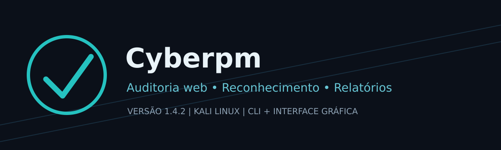
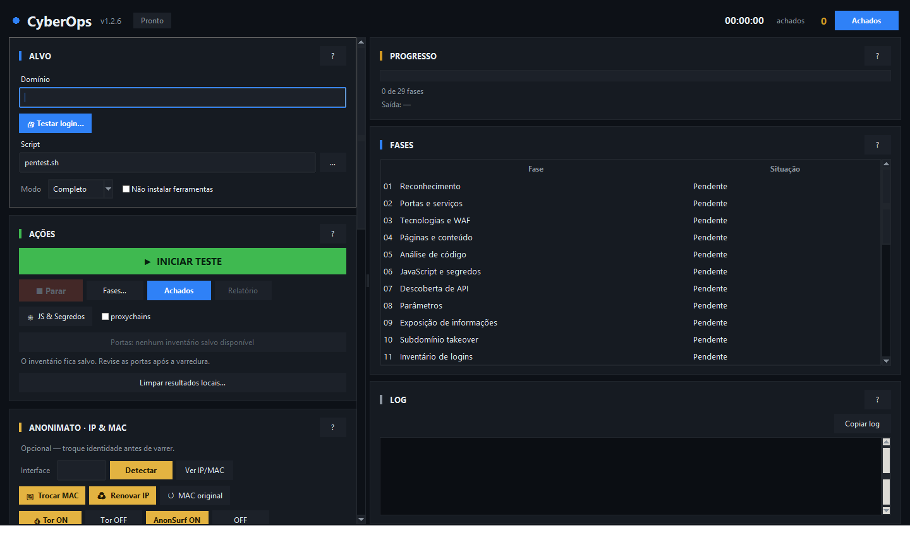
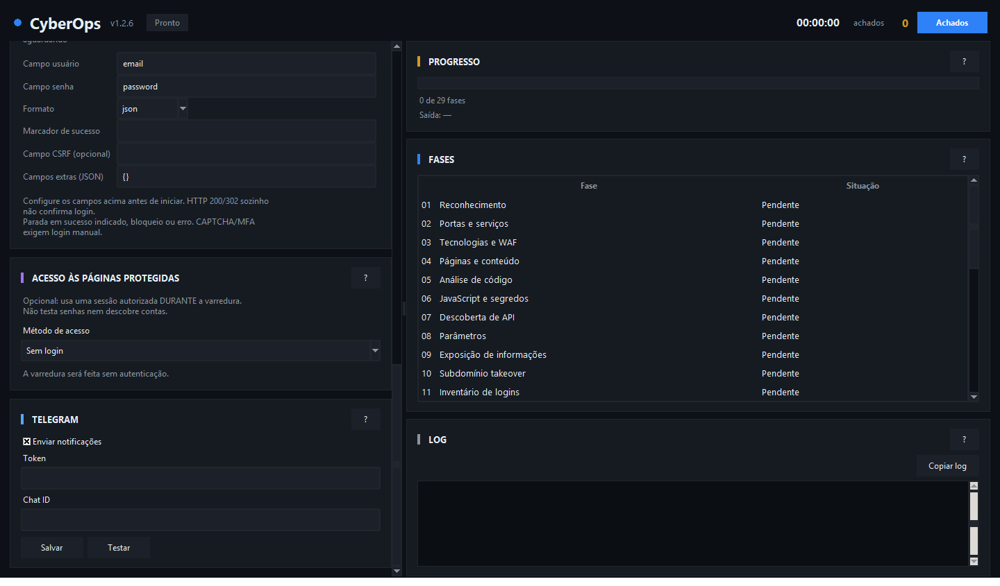

<p align="center"></p>

# OP Cybernetica I — v1.0.0

**Ferramenta de auditoria de aplicações web para Kali Linux**, com interface gráfica e terminal, reconhecimento de domínio, inventário técnico, acompanhamento de fases, relatórios HTML e envio opcional ao Telegram.

> **Uso responsável:** execute testes ativos somente em sistemas próprios ou com autorização explícita. O resultado de um scanner é uma hipótese técnica, não uma vulnerabilidade confirmada. Domínios de terceiros encontrados em páginas (CDNs, redes sociais etc.) não fazem automaticamente parte do escopo.

## Imagem real da interface



*Captura real do programa executado em ambiente Linux com servidor gráfico virtual, sem varredura em andamento. Não é uma montagem. A aparência pode variar no Kali.*

## Para que serve?

O OP Cybernetica I ajuda a **organizar auditorias de segurança web**: identifica dados públicos de registro do domínio (WHOIS/RDAP), DNS, serviços e tecnologias; inventaria páginas, JavaScript, APIs e cabeçalhos; coordena até 29 fases de verificações, conforme ferramentas disponíveis; registra saídas e indícios para análise manual. Permite gerar um **relatório HTML** de uma execução completa ou interrompida e enviá-lo a um chat Telegram configurado.

**Limites:** ferramentas externas podem precisar de instalação; nem todas as fases serão aplicáveis a todos os sites. O sistema não garante encontrar todas as falhas nem confirma automaticamente a exploração de vulnerabilidades. Os dados de titular e contato dependem da divulgação pública nos serviços de registro.

## Instalação no Kali Linux — Passo a passo

### 1. Instale os requisitos básicos

Abra o terminal do Kali Linux e execute:

```bash
sudo apt update
sudo apt install -y git python3 python3-tk bash curl whois dnsutils
```

### 2. Baixe o OP Cybernetica I

Clone o repositório oficial:

```bash
git clone https://github.com/Luistn/Pentest-cyberops.git
```

### 3. Entre na pasta do programa

```bash
cd Pentest-cyberops
```

### 4. Instale o sistema

```bash
bash instalar.sh
```

### 5. Abra a interface gráfica

```bash
cyberops open
```

### 6. Outros comandos disponíveis

**Exibir ajuda:**

```bash
cyberops --h
```

**Verificar a versão instalada:**

```bash
cyberops --versao
```

**Executar uma auditoria completa:**

```bash
cyberops --alvo "https://exemplo.com" --completo
```

**Executar uma auditoria profunda:**

```bash
cyberops --alvo "https://exemplo.com" --profundo
```

**Verificar atualizações:**

```bash
cyberops --atualizar
```

> **Importante:** utilize o OP Cybernetica I somente em sistemas próprios ou com autorização expressa para realizar auditorias de segurança.

6. Na interface, informe o domínio autorizado, selecione o modo e clique em **Iniciar teste**. Veja os resultados em **Log**, **Fases**, **Achados** e **Relatório**. Algumas fases exigem utilitários externos; consulte o log para dependências ausentes.

**Instalação por ZIP:** no GitHub, clique em **Code → Download ZIP**, extraia, abra o terminal dentro da pasta extraída e execute `bash instalar.sh`.

## Comandos do terminal

```bash
cyberops                           # abre a interface gráfica
cyberops open                      # abre a interface gráfica
cyberops --h                       # ajuda completa
cyberops --versao                  # versão instalada
cyberops --alvo https://exemplo.com --rapido
cyberops --alvo https://exemplo.com --completo
cyberops --alvo https://exemplo.com --profundo
cyberops --alvo https://exemplo.com --fases 1,2,3,6
cyberops --alvo https://exemplo.com --completo --obs "Auditoria autorizada"
cyberops --atualizar               # verifica atualizações
```

Para HTTP Basic em um ambiente de testes autorizado: `--usuario conta_teste --pedir-senha`. A senha é solicitada sem aparecer no histórico. Não coloque senhas em `--obs` ou no GitHub.

## Configurar o bot do Telegram

**Opcional.** Veja o tutorial ilustrado em [docs/TELEGRAM.md](docs/TELEGRAM.md). Resumo:

1. No Telegram, procure o bot oficial **@BotFather** e envie `/newbot`.
2. Escolha o nome e o nome de usuário do seu bot (deve terminar em `bot`). O BotFather fornecerá um **token secreto**: não publique nem compartilhe.
3. Abra a conversa com o bot recém-criado e envie `/start`.
4. Para descobrir o Chat ID, abra no navegador `https://api.telegram.org/botSEU_TOKEN/getUpdates`, substituindo `SEU_TOKEN` localmente. Procure `message.chat.id`. Se vier `result: []`, envie uma mensagem ao bot e tente novamente. **Não cole esse endereço com o token em issues ou prints públicos.**
5. Execute `cyberops open`, desça até a seção **TELEGRAM**, preencha **Token** e **Chat ID**, marque **Enviar notificações**, clique em **Salvar** e em **Testar**.
6. Ao terminar ou interromper uma varredura, o programa tenta enviar o HTML ao chat configurado. O envio depende de internet e das permissões do bot.



**Privacidade:** o relatório pode conter URLs e evidências sensíveis. Use chat privado. O token fica armazenado localmente em `~/.config/pentest-gui/telegram.json`; esse arquivo **não deve ser enviado ao GitHub**. Não exponha capturas com o token visível.

## Atualizações

Ao iniciar pelo comando `cyberops`, o programa pode consultar a release mais recente do GitHub e avisar se existir atualização, **sem instalar código remoto automaticamente**. Para ativar essa verificação, o mantenedor deve preencher `update_config.json` com o repositório real e publicar releases com tags como `v1.0.0`, `v1.0.1`.

Para atualizar uma instalação clonada:

```bash
cd ~/OP-Cybernetica-I   # ajuste para a pasta onde você clonou
 git pull --ff-only
bash instalar.sh
```

## Documentação adicional

- [Como publicar no GitHub, clicando tela por tela](docs/PUBLICAR_NO_GITHUB.md)
- [Como configurar o Telegram](docs/TELEGRAM.md)
- [Como tirar novas capturas reais](docs/CAPTURAS.md)
- [Histórico de versões](CHANGELOG.md)

## Segurança, privacidade e licença

Não envie ao repositório tokens, credenciais, cookies, relatórios, listas privadas ou logs de alvos reais. Revise `git status` e `git diff --cached` antes de publicar. Licença MIT em [LICENSE](LICENSE).
